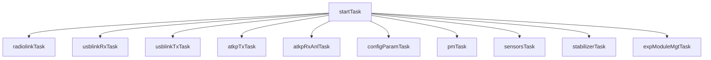
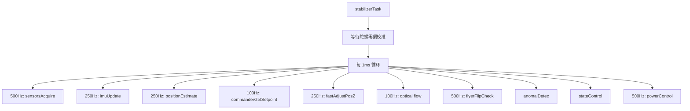
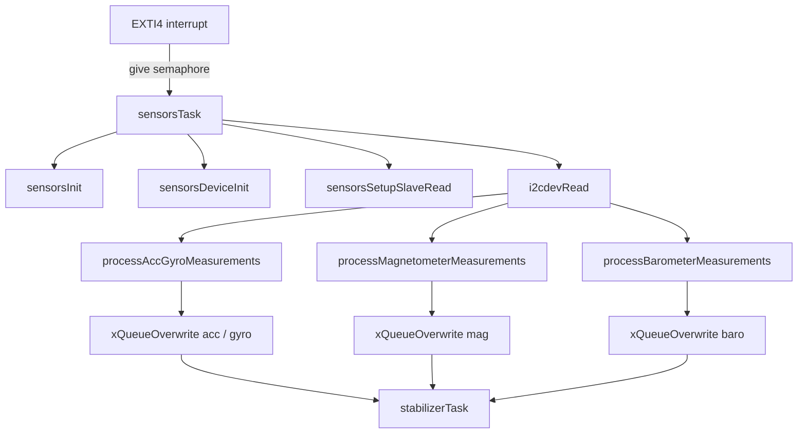
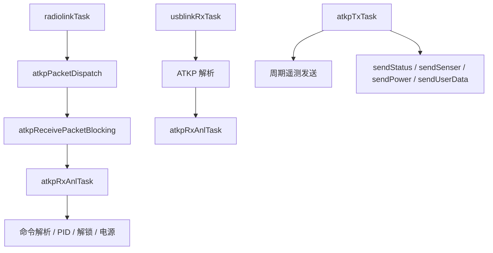
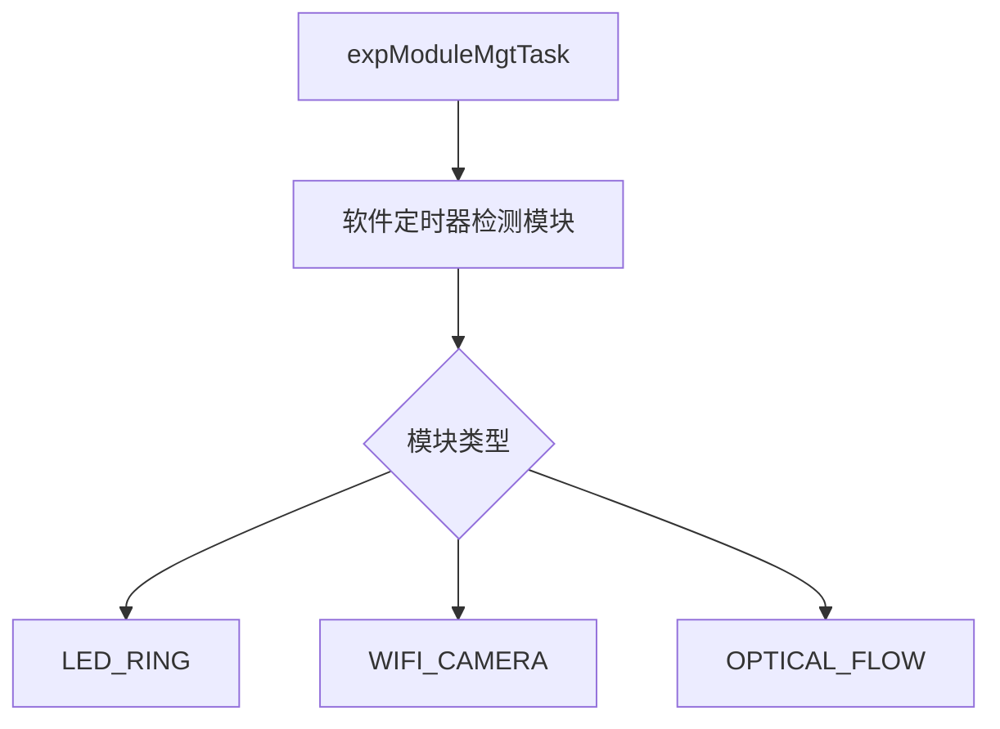

# MiniFly 代码结构图
# MiniFly Code Architecture Map

## 1. 总览
## 1. Overview

这份笔记用来快速看懂工程的启动顺序、任务划分和核心调用链。  
This note is for quickly understanding the startup sequence, task split, and core call chain.

代码主入口是 `USER/main.c`，系统初始化在 `systemInit()`，飞控核心循环在 `stabilizerTask()`。  
The main entry is `USER/main.c`, system setup happens in `systemInit()`, and the flight-control core loop runs in `stabilizerTask()`.

---

## 2. 初始化顺序
## 2. Initialization Order

```mermaid
flowchart TD
    R[Reset / 复位] --> S0[SystemInit()]
    S0 --> S1[nvicInit / extiInit / delay_init]
    S0 --> S2[ledInit / ledseqInit]
    S0 --> S3[commInit]
    S3 --> S31[radiolinkInit]
    S3 --> S32[usblinkInit]
    S0 --> S4[atkpInit / consoleInit]
    S0 --> S5[configParamInit / pmInit / stabilizerInit / expModuleDriverInit]
    S0 --> S6[systemTest]
    S6 --> S7[watchdogInit]
    S7 --> M0[main()]
    M0 --> M1[xTaskCreate(startTask)]
    M1 --> M2[vTaskStartScheduler()]
    M2 --> T0[startTask]
```

关键点：`main()` 先只创建 `startTask`，真正的业务任务都在 `startTask` 里批量创建。  
Key point: `main()` only creates `startTask` first, and all business tasks are created inside `startTask`.

---

## 3. 任务结构
## 3. Task Structure



任务可以粗分为 4 类：  
The tasks can be roughly grouped into 4 categories:

- 通信层：`radiolinkTask`、`usblinkRxTask`、`usblinkTxTask`、`atkpTxTask`、`atkpRxAnlTask`。  
- Communication layer: `radiolinkTask`, `usblinkRxTask`, `usblinkTxTask`, `atkpTxTask`, `atkpRxAnlTask`.
- 飞控层：`sensorsTask`、`stabilizerTask`。  
- Flight-control layer: `sensorsTask`, `stabilizerTask`.
- 管理层：`pmTask`、`configParamTask`、`expModuleMgtTask`。  
- Management layer: `pmTask`, `configParamTask`, `expModuleMgtTask`.
- 底层初始化：`systemInit()` 负责硬件和服务初始化。  
- Low-level setup: `systemInit()` handles hardware and service initialization.

---

## 4. 飞控主链路
## 4. Flight-Control Main Chain



这条链路可以理解成：先读传感器，再做姿态/位置估计，然后生成目标量，最后控制电机输出。  
You can read this chain as: read sensors first, then estimate attitude/position, then generate setpoints, and finally drive the motors.

---

## 5. 传感器数据流
## 5. Sensor Data Flow



`sensorsTask` 的作用是把原始传感器读数处理好，再放进队列，给飞控主循环使用。  
The role of `sensorsTask` is to process raw sensor readings and place them into queues for the flight loop.

---

## 6. 通信链路
## 6. Communication Path



无线和 USB 本质上都在传 ATKP 包，只是底层载体不同。  
Radio and USB both carry ATKP packets; only the transport layer differs.

---

## 7. 扩展模块
## 7. Extension Modules



它的作用是自动识别外挂模块，然后按模块类型初始化对应驱动。  
Its job is to auto-detect add-on modules and initialize the matching driver.

---

## 8. 一句话总结
## 8. One-line Summary

这套工程是“底层初始化 + FreeRTOS 多任务 + 传感器队列 + 飞控闭环 + 通信调参”的结构。  
This project is structured as "low-level init + FreeRTOS multitasking + sensor queues + flight-control loop + communication tuning".

